# NFC Card Writer — FPB-RA2E3 + PTX105R Quick-Connect PMOD

**Renesas Electronics — Confidential** · Rev 1.1 · October 2026

| Item | Value |
|---|---|
| MCU | R7FA2E3073CFL (RA2E3, Cortex-M23, 48 MHz) |
| NFC IC | PTX105R (ISO 14443-A/B, NFC-F, ISO 15693) |
| FSP | v6.5.0 + FreeRTOS 11.1.0 |
| NFC SDK | PTX NFC IoT-Reader SDK 3.0.0 |
| Toolchain | LLVM — Arm Toolchain for Embedded (ATfE) 21.1.1, picolibc |

---

## Table of Contents

1. [Overview](#1-overview)
2. [Key Features](#2-key-features)
3. [Demo Bring-Up](#3-demo-bring-up)
   - [Quick Start](#quick-start)
4. [Dependencies](#4-dependencies)
   - 4.1 [FPB-RA2E3 Fast Prototyping Board](#41-fpb-ra2e3-fast-prototyping-board)
   - 4.2 [PTX105R QC PMOD Board](#42-ptx105r-quick-connect-qc-pmod-board)
   - 4.3 [Pin Connections](#43-pin-connections)
   - 4.4 [USB UART](#44-usb-uart-cli--log)
   - 4.5 [Software Requirements](#45-software-requirements)
   - 4.6 [First-Time vs-code Setup](#46-first-time-vs-code-environment-setup)
5. [FSP Configuration](#5-fsp-configuration)
   - 5.1 [BSP Settings](#51-bsp-settings)
   - 5.2 [FSP Stack Overview](#52-fsp-stack-overview)
   - 5.3 [SCI0 SPI & ICU IRQ7 Properties](#53-sci0-spi--icu-irq7-properties)
   - 5.4 [Pin Assignments](#54-pin-assignments)
6. [Usage](#6-usage)
   - 6.1 [CLI Terminal](#61-cli-terminal)
   - 6.2 [LED Feedback](#62-led-feedback)
7. [Data Flow Architecture](#7-data-flow-architecture)
   - 7.1 [Project Structure](#71-project-structure)
   - 7.2 [Software-Layer Architecture](#72-software-layer-architecture)
   - 7.3 [FreeRTOS Task Map](#73-freertos-task-map)
   - 7.4 [Project Configuration](#74-project-configuration)
   - 7.5 [Project Functions](#75-project-functions)
8. [Callback Behavior](#8-callback-behavior)
   - 8.1 [Runtime Flow](#81-runtime-flow)
   - 8.2 [File-Level Ownership Flow](#82-file-level-ownership-flow)
   - 8.3 [NDEF Write Decision Flow](#83-ndef-write-decision-flow)
   - 8.4 [Stop Path Flow](#84-stop-path-flow)
9. [Configuration Parameters](#9-configuration-parameters)
10. [Error Handling](#10-error-handling)
11. [Limitations](#11-limitations)
12. [Integration Recommended](#12-integration-recommended)
    - 12.1 [Integration Guide](#121-integration-guide)
    - 12.2 [Adapting to Custom Board Wiring](#122-adapting-to-custom-board-wiring)
    - 12.3 [Integration Checklist](#123-integration-checklist)
13. [Example](#13-example)
14. [Troubleshooting](#14-troubleshooting)
15. [Summary](#15-summary)
16. [References & Documentation](#16-references--documentation)

---

## 1. Overview

This project demonstrates an interactive NFC card writer running on the Renesas RA2E3 microcontroller (R7FA2E3073CFL, Arm® Cortex®-M23). The PTX105R Quick-Connect (QC) PMOD Board connects to the FPB-RA2E3 via the PMOD1 connector (SPI on SCI0 + IRQ7) and supports all major NFC tag types out of the box.

The application is built on Renesas FSP v6.5.0 with FreeRTOS, compiled with the LLVM toolchain (ATfE 21.1.1, picolibc), and uses a layered software architecture:
APP (Application) → Writer module + Reader module → FSP Middleware + Drivers

Unlike the read-only NFC Card Reader project, this firmware is command-driven. A small CLI over the debug UART accepts one of three operations, then waits up to 15 s for a tag:

| Command | Behaviour |
|---|---|
| `read` | Read and print the tag's NDEF message (no modification) |
| `erase` | Read the tag, then erase its NDEF message and read-back verify it is empty |
| `write <text>` | Read the tag, then write an NDEF Text record built from `<text>` and read-back verify it |
| `help` (or `menu`, `?`) | Show the command menu |

The key architectural point is that the NFC Writer module does not own a discovery loop. It is a thin layer *on top of* the NFC Reader module: the application drives `rs_nfc_reader_Read()` as usual and, inside the reader's `on_card_event` callback — while the tag is still activated — calls the writer helpers to act on the tag that was just read. Both `write()` and `erase()` perform their read-back verification internally, so a returned `RS_OK` means the operation was applied and confirmed on the tag.

CLI input and all results are carried over the debug UART at 230400 baud on SCI9. Every console output line ends in CR+LF (`\r\n`), so the output displays correctly in terminals that do not translate a bare LF.

---

## 2. Key Features

In this project, the NFC workflow between the application and the FSP NFC middleware is orchestrated by two software modules, both using the `rs_` / `RS_` file and function prefixes:

| Module | Files | Responsibility |
|---|---|---|
| NFC Reader | `rs_nfc_reader.c/.h`, `rs_ndef_read.c`, `ptx105r/` | Discovery, activation, NDEF read, card summary, deactivation, and the PTX105R backend (`rs_nfc_ptx105r.c`) |
| NFC Writer | `rs_nfc_writer.c/.h`, `rs_nfc_writer_ndef.c/.h` | NDEF erase, write and standalone verify on an already-activated tag |

Both are delivered together, flattened into a single `src/` folder, because the writer
reuses the reader's read loop and PTX105R backend and ships no backend of its own —
it cannot be taken without the reader.

Core writer responsibilities:

- Erase the activated tag's NDEF message, then read-back verify it is empty (`rs_nfc_writer_erase`)
- Write a raw NDEF message, then read-back verify the content (`rs_nfc_writer_write`)
- Read a tag back and confirm it matches a supplied message (`rs_nfc_writer_verify`)
- Dispatch per tag type from `card->protocol`, so the application is payload-agnostic and tag-type agnostic

| NFC Standard | Tag Type | Example Cards | NDEF read | NDEF write / erase |
|---|---|---|---|---|
| ISO 14443-A | Type 2 (T2T) | MIFARE Ultralight, NTAG21x | Yes | Yes (hand-rolled TLV writer) |
| ISO 14443-A | Type 4A (T4A) | MIFARE DESFire, ISO-DEP | Yes | Yes (`ptxNDEF_T4TOP`) |
| ISO 14443-B | Type 4B (T4B) | ISO 14443-4 Type B cards | Yes | Yes (`ptxNDEF_T4TOP`) |
| NFC-F / FeliCa | Type 3 (T3T) | FeliCa Lite, FeliCa Standard | Not supported by the reader | Yes (`ptxNDEF_T3TOP`) |
| ISO 15693 | Type 5 (T5T) | NFC-V tags (ICODE SLIX, etc.) | Yes | Yes (`ptxNDEF_T5TOP`) |

> **Note on T3T:** the writer has a full write and read-back-verify path for Type 3 tags, even though the reader module does not decode T3T NDEF content into `result->decoded`. So `write`/`erase` work on FeliCa tags, while the `read` command will report the tag and UID without NDEF content.

---

## 3. Demo Bring-Up

> **Before you start:** the hardware, wiring and software you need are listed in 4. [Dependencies](#4-dependencies), including the USB UART the CLI runs over in 4.4 [USB UART](#44-usb-uart-cli--log). For vs-code, set up the tools once as described in 4.6 [First-Time vs-code Setup](#46-first-time-vs-code-environment-setup). The FSP configuration details in 5. [FSP Configuration](#5-fsp-configuration) are for reference only — the demo builds as shipped.

### Quick Start

On a machine that is already set up (see 4.6 [First-Time vs-code Setup](#46-first-time-vs-code-environment-setup)),
a fresh clone builds like this:

```bash
# 1. Generate the FSP content: ra/, ra_gen/ and ra_cfg/.
#    Run once per clone, and again after editing configuration.xml.
cd examples/fpb-ra2e3
cmake -P cmake/prebuild.cmake

# 2. Build
#    vs-code   - open ra2e3_nfc_writer.code-workspace, pick the LLVM (ATfE) kit,
#                then run the "Configure Project" and "Build Project" tasks
#    e2 studio - import examples/fpb-ra2e3 as an existing project, then Ctrl+B
```

The remainder of this section walks through the same flow in detail, including the
hardware setup and the flash/debug step.

### Step 1: Hardware Setup

1. Keep the FPB-RA2E3 unpowered (USB disconnected) while making connections.
2. Align pin 1 of the PTX105R QC board with pin 1 of PMOD1 on the FPB-RA2E3 and press firmly until seated.
3. Connect a micro-USB cable to J10. The board powers on, PTX105R receives 3.3 V through PMOD1 automatically, and the on-board J-Link OB enumerates both the debug probe and the virtual COM port used by the CLI. No external USB-UART adapter is needed.

### Step 2: Add Project to IDE

> **Note:** Use step 2.A for e² studio and step 2.B for vs-code

### Step 2.A: Import the Project into e² studio

1. Launch e² studio and select or create a workspace. The path must not contain spaces.
   `C:\workSpace` ← Good &nbsp;&nbsp; `C:\work Space` ← Bad
2. File → Import → General → Existing Projects into Workspace → Next.
3. Click Browse → navigate to the `examples/fpb-ra2e3` folder of this repository. The wizard detects RA2E3_nfc_writer automatically. Click Finish.
4. For bring-up, right-click the project → Build Configurations → Set Active → Debug.

> **Note:** there is no pre-build step and nothing to link — every source is a real
> file under `src/`. What *is* generated is the FSP layer: right-click the project →
> Generate Project Content (or open `configuration.xml` and press
> Generate Project Content) to produce `ra/`, `ra_gen/` and `ra_cfg/`. Those trees
> are deliberately not committed, so a fresh clone has none of them until you generate.
> This requires FSP 6.5.0 and the `Renesas.PTX.3.0.0+fsp.6.5.0` pack to be installed
> in e² studio.

### Step 2.B: Open Project into vs-code

1. Launch vs-code and File → Open Workspace from File.
2. Navigate to `examples/fpb-ra2e3` and select `ra2e3_nfc_writer.code-workspace`.
3. On the popup window, select ARM LLVM (ATfE) - Ninja (LLVM-embedded-toolchain-for-Arm (clang) with Ninja).
4. The default build configuration is Debug, and this is the one you need.

> **Note:** if `ra/`, `ra_gen/` or `ra_cfg/` are missing, the first CMake configure
> generates them automatically by running RASC (`cmake/prebuild.cmake`), so a fresh
> clone needs no manual generate step. This requires RASC with FSP 6.5.0 and the
> `Renesas.PTX.3.0.0+fsp.6.5.0` pack — see 4.6 [First-Time vs-code Setup](#46-first-time-vs-code-environment-setup).

### Step 3: Review FSP Configuration

Double-click `configuration.xml` to open the RA Configuration view. Verify BSP tab (device R7FA2E3073CFL, FSP 6.5.0), Stacks tab (full NFC driver stack), and Pins tab (SCI0 + IRQ7 assignments). Full details are in 5. [FSP Configuration](#5-fsp-configuration).

### Step 4: Build

> **Note:** Use step 4.A for e² studio and step 4.B for vs-code

### Step 4.A: Build e² studio

1. Confirm the active build configuration is Debug (Release carries the same size settings).
2. Press Ctrl+B or right-click the project → Build Project.
3. A successful build prints zero errors. Output files are written to `Debug/`:
   `RA2E3_nfc_writer.elf` · `.srec` · `.map`

### Step 4.B: Build vs-code

1. Press the Build icon on the bottom bar, or the Build button in the CMake tool on the right panel (or run the Build Project task).
2. A successful build prints zero errors and ends with `Build finished with exit code 0`.
3. Output files are written to `build/Debug/`: `ra2e3_ptx_Iot_fsp_writer.elf` · `.hex` · `.map` · `.sbd` (the debug bundle consumed by the Renesas debugger).

> **Note:** the image only fits in the 64 KB code flash with the size settings already in
> the project, in both IDEs and both configurations: Optimization Level -Oz, Link-time optimizer
> (-flto) and linker Identical code folding: safe (`-Wl,--icf=safe`). In e² studio they
> are set in the project properties; for vs-code, `CMakeLists.txt` applies the same flags. The console uses
> `src/console_io` instead of libc `printf`, so no C library stdio is linked. Keep these
> settings when you change the project — see [9. Configuration Parameters](#9-configuration-parameters).

### Step 5: Flash & Run

> **Note:** Use step 5.A for e² studio and step 5.B for vs-code. Open the
> serial terminal on the J-Link OB VCOM port (230400 8N1) before resuming, so you see the menu.

### Step 5.A: Flash & Run e² studio

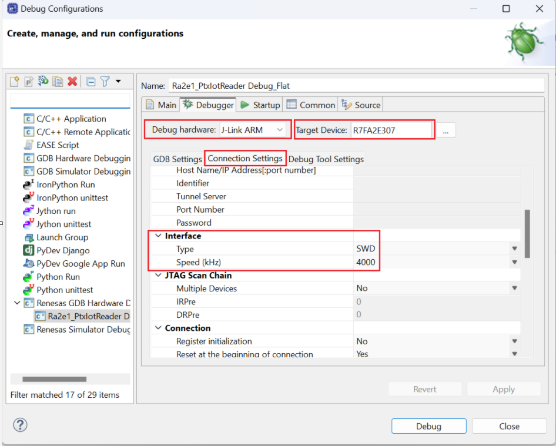

*Figure 1 — Debug Config*

1. Confirm the micro-USB cable is connected to J10 and the board is powered.
2. Run → Debug Configurations... → double-click Renesas GDB Hardware Debugging → Debug_Flat.
3. If configuring manually, verify the Debugger tab: J-Link (Renesas), target R7FA2E307, interface SWD at 4 MHz.
4. Click Debug. e² studio downloads `Debug/RA2E3_nfc_writer.elf` to the RA2E3 via J-Link and halts at `main()`.
5. Press Resume (F8) to start execution.

### Step 5.B: Flash & Run vs-code

1. Confirm the micro-USB cable is connected to J10 and the board is powered.
2. Press Ctrl+Shift+D to open Run and Debug and pick Renesas GDB Debugging Default (the Renesas J-Link debugger, configured in `.vscode/launch.json` for target R7FA2E307). It loads `build/Debug/ra2e3_ptx_Iot_fsp_writer.elf`.
3. To use an external J-Link GDB server instead, pick Renesas GDB Debugging Server and check in `launch.json`:
   1) "gdbTarget" — remote IP:GDB port (default `localhost:2331`)
   2) "gdbPath" — GDB path (taken from the `ARM_GDB_PATH` environment variable)
   3) "device" — target device (`"R7FA2E307"`)
4. Press F5 / Start Debugging; vs-code downloads the `.elf` to the RA2E3 via J-Link and halts at `main()`.
5. Use the debug toolbar to continue.

Call chain (both IDEs):
```
main()                              ← FSP generated
└─ new_thread0_entry()              ← calls app_nfc_writer_entry()
   └─ app_nfc_writer_entry()        ← prints menu, then loops forever
      └─ app_read_line()            ← blocks on console_io_getc() over SCI9
         └─ app_handle_command()
            └─ app_run_op()
               └─ rs_nfc_reader_Read()   ← BLOCKING (cfg.callback == NULL)
                  └─ on_nfc_card_event() ← rs_nfc_writer_erase / _write here
```

> **Note:** For integration into your own project or customer hardware, check 12. [Integration Recommended](#12-integration-recommended) for the required differences (BSP device selection, pin/channel remap, and stack configuration updates). This Section flow is for running the packaged demo on the reference hardware.

---

## 4. Dependencies

### 4.1 FPB-RA2E3 Fast Prototyping Board

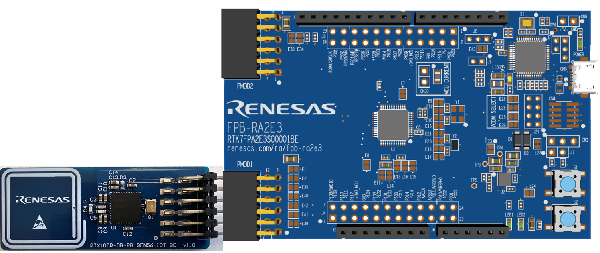

*Figure 2 — FPB-RA2E3 with PTX105R QC board seated in PMOD1*

| Resource | Detail |
|---|---|
| MCU | R7FA2E3073CFL — Arm Cortex-M23, 48 MHz HOCO |
| Flash / RAM | 64 KB Flash / 16 KB RAM (FreeRTOS overhead ~10 KB) |
| PMOD1 | SPI via SCI0 (P100/P101/P102/P103) + IRQ7 (P015) |
| Debug UART | SCI9 on P109 (TXD) / P110 (RXD) — 230400 8N1, bidirectional (carries the CLI) |
| Debug interface | J10 Micro-USB → on-board J-Link OB (SWD) |
| LEDs | LED1 (P213) and LED2 (P914 / `PMOD1_GPIO9`) — both driven high together for the duration of each card transaction, then low. (P913 is `PMOD1_GPIO10` and P915 is `PMOD1_RESET`; neither is used as an LED by the current firmware.) |
| User button | SW1 (P200 / NMI) |

### 4.2 PTX105R Quick-Connect (QC) PMOD Board

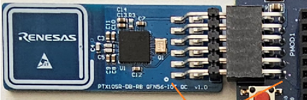

*Figure 3 — PTX105R-DB-RB QFN56-IOT QC v1.0 board*

| Feature | Detail |
|---|---|
| NFC IC | PTX105R |
| RF Protocols | ISO 14443-A/B, NFC-F (FeliCa), ISO 15693 |
| Antenna | Integrated 20 × 20 mm loop, on-board |
| Interface | 12-pin PMOD connector — plug directly into FPB-RA2E3 PMOD1 |
| SPI | 1 MHz, CPHA=0, CPOL=0 (SPI Mode 0), active-low CS |
| IRQ | Active-high rising edge on PMOD1 pin 7 (P015 / ICU IRQ7) |
| Power | 3.3 V from PMOD rail |

### 4.3 Pin Connections

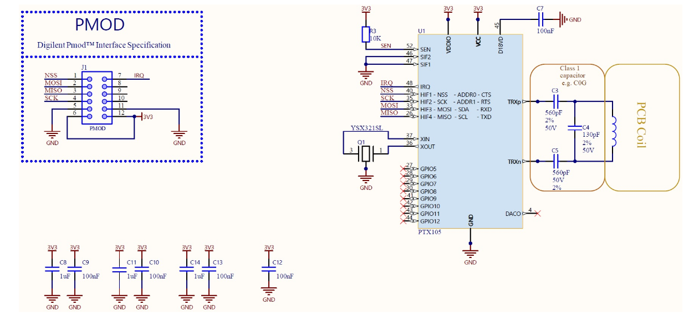

*Figure 4 — PTX105R-Schematic*

| PMOD1 Pin | Signal | FPB-RA2E3 Pin | SCI0 Function | Description |
|---|---|---|---|---|
| 1 | MISO | P100 | SCI0 RXD0 | Data from PTX105R to RA2E3 |
| 2 | MOSI | P101 | SCI0 TXD0 | Data from RA2E3 to PTX105R |
| 3 | SCK | P102 | SCI0 SCK0 | SPI clock (1 MHz, Master) |
| 4 | SS / CS | P103 | GPIO output | Chip select (active-low, software-driven GPIO, idle high) |
| 5 | GND | GND | — | Ground |
| 6 | 3V3 | 3.3 V | — | Power supply to PTX105R |
| 7 | IRQ | P015 | ICU IRQ7 | Active-high interrupt from PTX105R |
| 8 | RESET | P915 | GPIO (`PMOD1_RESET`) | PTX105R reset line (macro defined; not driven by current firmware) |

### 4.4 USB UART (CLI + Log)

The CLI and all log output share the board's USB UART connection. Connect the FPB-RA2E3 to your PC with the USB cable on J10, then open the enumerated COM port in your serial terminal.

> **Important:** unlike the read-only NFC Card Reader demo, this application cannot run headless. The UART is bidirectional here — `app_read_line()` blocks on `console_io_getc()` waiting for a command, so with no terminal attached the firmware sits at the `nfc>` prompt and never performs an operation.
>
> The two modules themselves have no UART dependency. Only the demo application's CLI does; drive the writer helpers from your own code and the UART becomes optional again.

### 4.5 Software Requirements

| Software | Version / Notes |
|---|---|
| Renesas e² studio | 2026-04 or later, with FSP 6.5.0 installed (for the e² studio flow; it also installs the LLVM toolchain) |
| vs-code | With the Renesas extensions and CMake Tools — for the vs-code flow, see 4.6 [First-Time vs-code Setup](#46-first-time-vs-code-environment-setup) |
| RA Smart Configurator (RASC) | With FSP 6.5.0 — used by the vs-code / CMake flow to generate `ra/`, `ra_gen/`, `ra_cfg/` |
| Renesas FSP | v6.5.0 |
| LLVM toolchain | Arm Toolchain for Embedded (ATfE) 21.1.1 with picolibc (bundled with the FSP installer) |
| PTX NFC IoT-Reader SDK | 3.0.0 — `rm_nfc_reader_ptx_sdk`, pack `Renesas.PTX.3.0.0+fsp.6.5.0` |
| FreeRTOS | 11.1.0 via FSP (rm_freertos_port + heap_4) |
| Serial terminal | Tera Term, PuTTY or any console app — 230400 8N1, with keyboard input |

For detailed steps on using e² studio, refer to the Renesas e² studio User Guide:
[e² studio | Renesas](https://www.renesas.com/en/software-tool/e2-studio?srsltid=AfmBOorTMc82ySC1OUrEN8SZbrQK2qXPYpFT_VatUYLmZMBeViM4bFTS)

The PTX105R IoT-Reader SDK arrives with the FSP `rm_nfc_reader_ptx` stack, under
`ra/renesas/wireless/ptx/rm_nfc_reader_ptx_sdk/` — no separate SDK download is
required. That path is part of the generated `ra/` tree, so it appears once the
project has been imported and its content generated (see
[3. Demo Bring-Up](#3-demo-bring-up)).

There is nothing to initialise before the first build: this repository has no
submodules and no generated links. The console that carries the CLI is
vendored directly as `src/console_io/` (`console_io.c/.h`: minimal printf output
plus UART receive, no libc stdio), and both modules are vendored as
`src/rs_nfc_card_writer/`. Clone, import, generate, build.

### 4.6 First-Time vs-code Environment Setup

Before generating, building, or debugging in vs-code, install the tools below and
point a handful of environment variables at them once per machine. The
vs-code and CMake configuration reads those variables to locate each toolchain,
so any installed version works — nothing is hard-coded to a specific release.

#### Install these first

Make sure the following are available on the machine:

| Tool | How to get it | Required? |
|---|---|---|
| vs-code | [Visual Studio Code](https://code.visualstudio.com) | Yes (code editor) |
| LLVM (ATfE) Arm toolchain | Installed with e² studio (Help ▸ Add Renesas Toolchains), or download from [arm/arm-toolchain releases](https://github.com/arm/arm-toolchain/releases) (assets named `ATfE-*`) | Yes (compile) |
| RA Smart Configurator (RASC) | [Renesas RA Smart Configurator](https://www.renesas.com/en/software-tool/ra-smart-configurator) | Yes (regenerate) |
| CMake (bundles Ninja) | [cmake.org/download](https://cmake.org/download/) or `winget install Kitware.CMake` | Yes (build) |
| Arm GNU toolchain (`arm-none-eabi-gdb`) | [Arm GNU Toolchain downloads](https://developer.arm.com/downloads/-/arm-gnu-toolchain-downloads) or `winget install Arm.ArmGnuToolchain` | Only for hardware debug |

> The LLVM (ATfE) toolchain and RASC are installed by the Renesas installers.
> CMake, Ninja, and the Arm GNU debugger are *not* — install them
> separately if they are not already present.

#### Set these environment variables

| Variable | Point it at | Used for |
|---|---|---|
| `ARM_TOOLCHAIN_PATH` | LLVM (ATfE) `bin` folder | Compiling the project (required) |
| `CMAKE_PATH` | the `cmake` executable | Configuring & building (required) |
| `NINJA_PATH` | Ninja `bin` folder | Building |
| `ARM_GDB_PATH` | the `arm-none-eabi-gdb` executable | Hardware debugging (optional) |
| `RASC_EXE_PATH` | the RASC `rasc.exe` | Regenerating FSP files (optional) |

`ARM_TOOLCHAIN_PATH` is also honoured under the toolchain-specific aliases
`ARM_LLVM_TOOLCHAIN_PATH` and `ARM_GCC_TOOLCHAIN_PATH`, so both compilers can be
registered side by side. `RASC_EXE_PATH` is optional: `Config.cmake` falls back to
searching the standard install locations (`C:/Renesas/RA/sc_v*/eclipse/rasc.exe`
and `%LOCALAPPDATA%/Programs/Renesas/RA/sc_v*`) and picks the newest it finds.

Windows — set them as *user* environment variables (no admin rights needed),
either through Settings ▸ System ▸ About ▸ Advanced system settings ▸
Environment Variables, or from a terminal with `setx`:

```bat
setx ARM_TOOLCHAIN_PATH "C:\Path\To\ATfE\bin"
setx CMAKE_PATH        "C:\Program Files\CMake\bin\cmake.exe"
setx NINJA_PATH        "C:\Program Files\CMake\bin"
setx ARM_GDB_PATH      "C:\Path\To\ArmGNUToolchain\bin\arm-none-eabi-gdb.exe"
setx RASC_EXE_PATH     "C:\Renesas\RA\sc_v2026-04_fsp_v6.5.0\eclipse\rasc.exe"
```

> `setx` only affects new processes — the terminal you typed it in keeps the
> old values.

Linux / macOS — add the exports to your shell profile (`~/.profile` or
`~/.bashrc`), then `source` it or log out and back in:

```bash
export ARM_TOOLCHAIN_PATH="$HOME/toolchains/ATfE/bin"
export CMAKE_PATH="/usr/bin/cmake"
export NINJA_PATH="/usr/bin"
export ARM_GDB_PATH="/usr/bin/arm-none-eabi-gdb"
```

Install any missing tools with your package manager, e.g.
`sudo apt install cmake ninja-build gdb-arm-none-eabi`.

> **IMPORTANT:** After setting the variables, close and re-open vs-code so it
> picks up the new environment.

## 5. FSP Configuration

FSP configuration is done in e² studio, in the RA Configuration editor opened from `configuration.xml`. For the general workflow, refer to:

- e² studio: [e² studio Integrated Development Environment User's Manual: Quick Start Guide](https://www.renesas.com/en/document/qsg/renesas-ra-family-e2-studio-2023-10-or-higher-quick-start-guide?r=488826) — See CHAPTER 3: PROJECT GENERATION

### 5.1 BSP Settings

| Setting | Value |
|---|---|
| FSP Version | 6.5.0 |
| Board | FPB-RA2E3 (board.ra2e3_fpb) |
| Device | R7FA2E3073CFL · LQFP48 · Cortex-M23 |
| RTOS | FreeRTOS (rm_freertos_port) |
| ROM / RAM | ~64 KB / ~16 KB |
| Main stack | 1,024 bytes |
| Heap | 256 bytes — BSP / C library heap (FreeRTOS `heap_4` has its own 2,048 bytes; see [Heap](#heap)) |
| MCU Vcc | 3,300 mV |
| Toolchain | LLVM — ATfE 21.1.1 with picolibc |

### 5.2 FSP Stack Overview

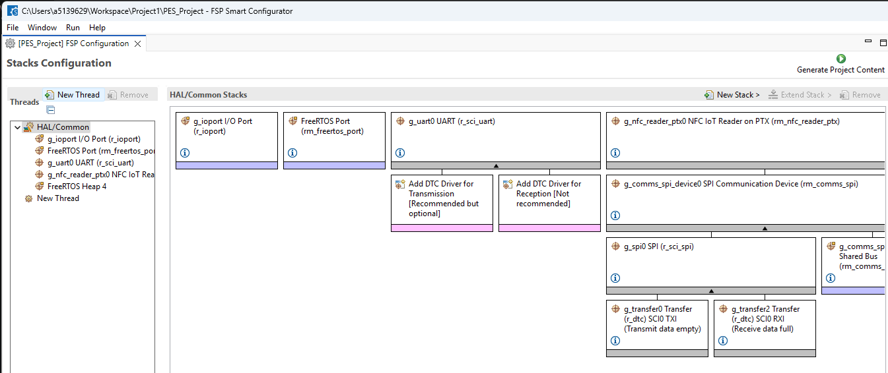

*Figure 5a — FSP Stacks tab: HAL/Common top-level view*

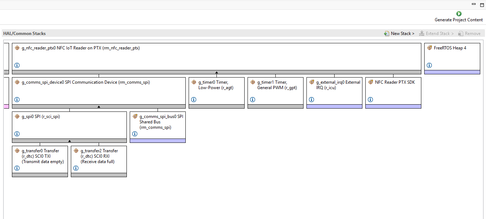

*Figure 5b — FSP Stacks tab: g_nfc_reader_ptx0 full stack expanded*

The FSP stack is identical to the NFC Card Reader project's — the writer adds no
FSP module of its own, it only adds C source that talks to the same PTX SDK
components through the reader's backend.

| FSP Module | Instance | Role |
|---|---|---|
| `rm_nfc_reader_ptx` | `g_nfc_reader_ptx0` | Config/context instance only — the `RM_NFC_READER_PTX_*` is bypassed; `rs_nfc_ptx105r.c` reads `g_nfc_reader_ptx0_cfg` and drives `ptxIoTRd_*` directly (see [7.1 Project Structure](#71-project-structure)) |
| `rm_nfc_reader_ptx_sdk` | — | PTX105R SDK v3.0.0 (NSC stack, RF protocol engine, `ptxNDEF_T3TOP`/`T4TOP`/`T5TOP`) |
| `rm_comms_spi` (bus) | `g_comms_spi_bus0` | SPI bus abstraction with mutex + blocking semaphore |
| `rm_comms_spi` (device) | `g_comms_spi_device0` | SPI device instance for PTX105R (CS active-low) |
| `r_sci_spi` | `ptx_pmod_spi` | SCI0 SPI Master — 1 MHz, CPHA=0, CPOL=0, MSB-first |
| `r_dtc` (TX + RX) | `g_transfer0` / `g_transfer1` | DTC for zero-CPU SPI DMA transfer |
| `r_icu` | `g_ext_irq` | ICU IRQ7 on P015 — rising-edge interrupt from PTX105R |
| `r_gpt` | `g_timer0` | GPT Ch0 — TDC timer, callback: ptxPLAT_TIMER_IsrCallback |
| `r_gpt` | `g_timer1` | GPT Ch1 — second PTX timing channel |
| `r_sci_uart` | `g_uart_jlob_vcom` | SCI9 — 230400 8N1 UART on P109 (TX) / P110 (RX) — CLI and log |
| `r_ioport` | `g_ioport` | GPIO — LEDs, PMOD1_RESET (P915) |
| FreeRTOS thread | `new_thread0` | Application task — 5,120 B stack, priority 1 |
| `heap_4` | FreeRTOS heap | Kernel heap — `configtotal_heap_size` 2,048 B (idle hook enabled) |

### 5.3 SCI0 SPI & ICU IRQ7 Properties

**SCI0 SPI (ptx_pmod_spi)**

| Property | Value |
|---|---|
| Channel | SCI0 |
| Mode | Master |
| CPHA | 0 (leading edge) |
| CPOL | 0 (clock idle low) |
| Bit Order | MSB First |
| Bitrate | 1,000,000 bps |

**ICU IRQ7 (g_ext_irq)**

| Property | Value |
|---|---|
| Channel | 7 (P015) |
| Trigger | Rising Edge |
| Priority | 2 |

> **Note:** Move to another ICU IRQ if PTX IRQ is rerouted to a different external IRQ-capable pin, then FSP pin + ICU configuration is updated and code is regenerated (for example, vectors/common_data will change accordingly). For the rest of this document, we use ICU IRQ7.

### 5.4 Pin Assignments

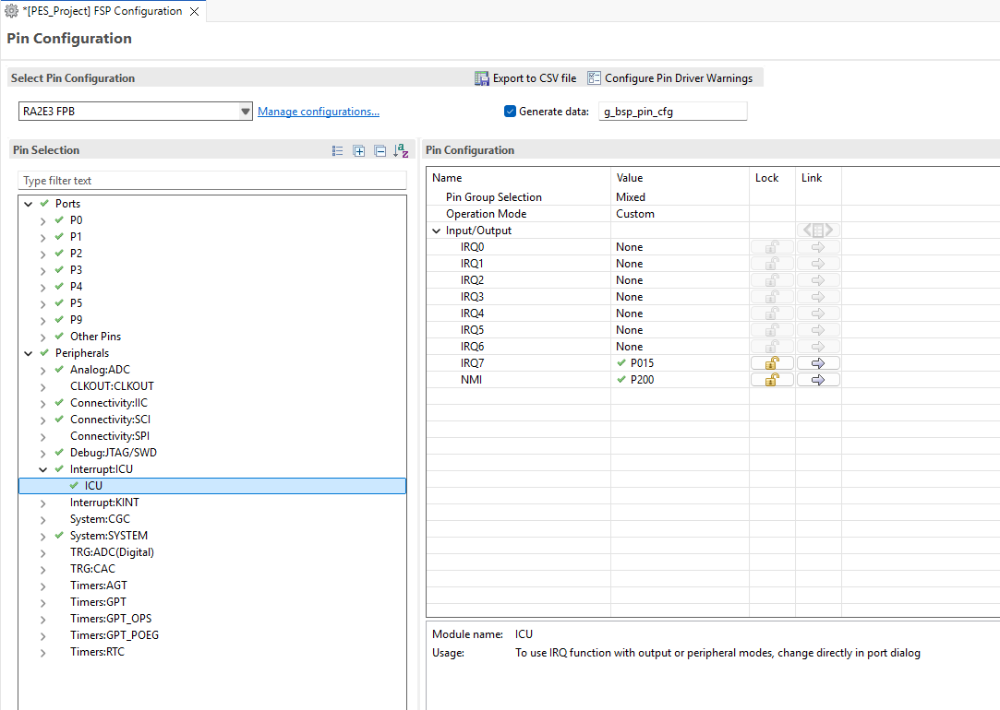

*Figure 6 — Assignments*

| Peripheral | Pin | Symbolic Name | Function |
|---|---|---|---|
| SCI0 RXD0 | P100 | `ARDUINO_D12_MISO_PMOD1_MISO` | SPI MISO ← PTX105R |
| SCI0 TXD0 | P101 | `ARDUINO_D11_MOSI_PMOD1_MOSI` | SPI MOSI → PTX105R |
| SCI0 SCK0 | P102 | `ARDUINO_D13_SCK_PMOD1_SCK` | SPI Clock |
| GPIO output | P103 | `ARDUINO_D10_SS_PMOD1_SS` | SPI CS (active-low, software GPIO) |
| ICU IRQ7 | P015 | `PMOD1_IRQ7` | PTX105R interrupt |
| SCI9 TXD9 | P109 | `ARDUINO_D1_TX` | UART TX → PC (prompt, echo, results) |
| SCI9 RXD9 | P110 | `ARDUINO_D0_RX` | UART RX ← PC (CLI commands — required) |
| GPIO (unused) | P915 | `PMOD1_RESET` | PTX105R RESET line (not driven by firmware) |

---

## 6. Usage

### 6.1 CLI Terminal

1. Open your serial terminal (Tera Term, PuTTY or any console app) at 230400 baud, 8N1. Make sure the terminal sends keystrokes — this is an interactive session, not a log stream.

2. On startup the application prints the banner and menu:

```
NFC Card Writer ready

NFC Card Writer
  read         read the tag
  erase        erase the tag
  write <text> write a Text record
  help         this menu

nfc>
```

3. Type a command and press Enter. The firmware then waits up to 15 s (`APP_CLI_CARD_TIMEOUT_MS`) for a tag placed within 5–10 cm of the PTX105R antenna.

**`read`** — reports the tag without modifying it:

```
nfc> read

Present a tag...

CARD DETECTED! type=NFC-T4A UID=02840017810196 NDEF=15B
RF tech  : TYPE A
Tag type : ISO-DEP (Type 4 Tag / ISO 14443-4)
UID      : 02:84:00:17:81:01:96
Size     : 8192 B
Writeable: Yes
NDEF     : 15 B
Raw      : D1 01 0B 54 02 65 6E 59 4F 20 45 4C 49 4E 41
Records  : 1
[0] TNF=0x01 (Well-known) Type='T'  Payload=11 bytes
  Text: "YO ELINA"
```

**`write <text>`** — builds an NDEF Text record, writes it, and verifies the read-back:

```
nfc> write 1234

Present a tag...

CARD DETECTED! type=NFC-T2T UID=044536DAE84C81 NDEF=11B
RF tech  : TYPE A
Tag type : NFC Forum Type 2 Tag (T2T)
UID      : 04:45:36:DA:E8:4C:81
Size     : 144 B
Writeable: Yes
NDEF     : 11 B
Raw      : D1 01 07 54 02 65 6E 31 31 31 31
Records  : 1
[0] TNF=0x01 (Well-known) Type='T'  Payload=7 bytes
  Text: "1111"
-> Written + verified (11 B): "1234"
```

The card dump reflects the tag before the write, because the reader reads it on activation. The confirmation line reports what was written.

The text may be quoted (`write "Hello NFC"`); one surrounding pair of double quotes is stripped. The record produced is a single NFC Forum well-known RTD_TEXT record, language `en`, UTF-8:

```
D1 01 <plen> 54 02 'e' 'n' <text...>
```

**`erase`** — erases the NDEF message and verifies the tag reads back empty:

```
nfc> erase

Present a tag...

CARD DETECTED! type=NFC-T4A UID=02840017810196 NDEF=15B
...card info as above...
-> Erased
```

If no tag arrives inside the timeout, the command reports and returns to the prompt:

```
No tag (timeout)
```

Each command is one-shot: `on_nfc_card_event` calls `rs_nfc_reader_Stop()` after the first tag, so the CLI returns to the prompt instead of looping over further tags.

### 6.2 LED Feedback

On every card transaction the firmware drives LED1 (P213) and LED2 (P914 / `PMOD1_GPIO9`) HIGH together at the start of the card event, then LOW once the card has been processed. There is no per-card-type LED coding and no timed blink — the two LEDs simply act as a single "card active" indicator, and they do not distinguish a successful write from a failed one (check the UART for that).

| Event | LED Action |
|---|---|
| Card detected / being processed | LED1 + LED2 driven HIGH |
| Field clear / processing done | LED1 + LED2 driven LOW |

> **Note:** LED feedback is compiled in via `APP_NFC_WRITER_LED_EN` in `app_nfc_writer.h`; comment out that macro to disable LED code entirely.

---

## 7. Data Flow Architecture

### 7.1 Project Structure

This repository is self-contained: every source the firmware needs is a real file,
with no submodules and no generated links. The project source is delivered twice on
purpose — once at the repo root as the module deliverable, and once inside the
example project as the copy e² studio compiles.

```
rs-nfc-card-writer/
│
├── README.md                               ← this document
├── src/                                    ← Project deliverable (both modules, flattened)
│   ├── rs_nfc_writer.h                     ← writer public header (single include)
│   ├── rs_nfc_writer.c                     ← op selector + argument/capacity guards
│   ├── rs_nfc_writer_ndef.c/.h             ← per-tag-type write / erase / verify
│   ├── rs_nfc_reader.h                     ← reader public header (shared types)
│   ├── rs_nfc_reader.c                     ← modes, event loop, retry, card summary
│   ├── rs_ndef_read.c                      ← NDEF read + record decode
│   └── ptx105r/rs_nfc_ptx105r.c/.h         ← PTX105R backend (shared by both)
│
├── readme_assets/                          ← images used by this README
│
└── examples/fpb-ra2e3/                     ← the runnable e2 studio project
    ├── README.md                           ← redirect to this document
    ├── src/
    │   ├── hal_entry.c                     ← FSP HAL entry hook
    │   ├── new_thread0_entry.c             ← FreeRTOS task entry → app_nfc_writer_entry()
    │   ├── app/                            ← APP Layer
    │   │   ├── app_nfc_writer.c/.h         ← CLI, NDEF Text builder, card-event callback, LEDs
    │   │   └── app_nfc_writer_log.c/.h     ← UART log + card-info print
    │   ├── rs_nfc_card_writer/            ← copy of the root src/ above (compiled here)
    │   └── console_io/                     ← UART console: minimal printf + RX (no libc stdio)
    ├── configuration.xml                   ← FSP stack + pin config (the RASC input)
    ├── script/fsp.lld                      ← Linker script
    ├── .project, .cproject, .settings/     ← e2 studio project (managed build, Debug + Release)
    ├── Debug_Flat.launch                   ← J-Link debug launch
    ├── ra/                                 ← GENERATED: FSP + CMSIS + FreeRTOS + PTX SDK
    ├── ra_gen/                             ← GENERATED: FSP glue (do not edit)
    └── ra_cfg/                             ← GENERATED: FSP config headers (do not edit)
```

> **Note:** `ra/`, `ra_gen/` and `ra_cfg/` are not in the repository. They are
> produced from `configuration.xml` by Generate Project Content and are excluded by
> `.gitignore`, so a fresh clone does not contain them — see
> [3. Demo Bring-Up](#3-demo-bring-up). Never edit them by hand; the FSP tooling
> rewrites them whenever `configuration.xml` is saved.
>
> **On the duplicated project source:** `src/` (repo root) is the module as delivered, and
> `examples/fpb-ra2e3/src/rs_nfc_card_writer/` is the byte-identical copy that the
> example project compiles, so the project builds from its own folder with no path escapes. If
> you change one, change the other — `diff -r src examples/fpb-ra2e3/src/rs_nfc_card_writer`
> should stay empty.

### 7.2 Software-Layer Architecture

Use this mental model: each layer has one clear responsibility and only calls the layer directly below it. The writer sits *beside* the reader at the module level, not below it.

| Layer | Main responsibility | Key files |
|---|---|---|
| Application (APP) | CLI parsing, NDEF Text record building, logs, LED | `src/app/app_nfc_writer.c`, `src/new_thread0_entry.c` |
| Writer module | NDEF erase / write / verify on an activated tag | `src/rs_nfc_card_writer/rs_nfc_writer.c`, `rs_nfc_writer_ndef.c` |
| Reader module | NFC state machine (discover, activate, read, callback, deactivate, loop) | `src/rs_nfc_card_writer/rs_nfc_reader.c`, `rs_ndef_read.c` |
| PTX105R adapter | Converts module calls to PTX SDK operations | `src/rs_nfc_card_writer/ptx105r/rs_nfc_ptx105r.c`, `rs_nfc_ptx105r.h` |
| PTX SDK + FSP drivers | NFC protocol ops and MCU peripheral access | `ptxIoTRd_*`, `ptxNDEF_T*OP*`, `ptxPLAT_*`, `R_SCI_SPI`, `R_ICU`, `R_GPT` |
| Hardware | Physical RF + MCU execution platform | RA2E3 board + PTX105R PMOD |

**Important boundaries**

- The PTX adapter (`rs_nfc_ptx105r.c`) calls `ptxIoTRd_*` directly. The `RM_NFC_READER_PTX_*` wrapper layer is intentionally bypassed in this project.
- The writer owns no backend. `rs_nfc_writer_ndef.c` reaches the PTX NDEF components through the reader's accessors (`rs_nfc_ptx_get_ndef_comp()`, `..._t3t_comp()`, `..._t5t_comp()`), which is why `src/rs_nfc_card_writer/ptx105r` is on the include path alongside `src/rs_nfc_card_writer` itself.

**Call flow (top-down)**

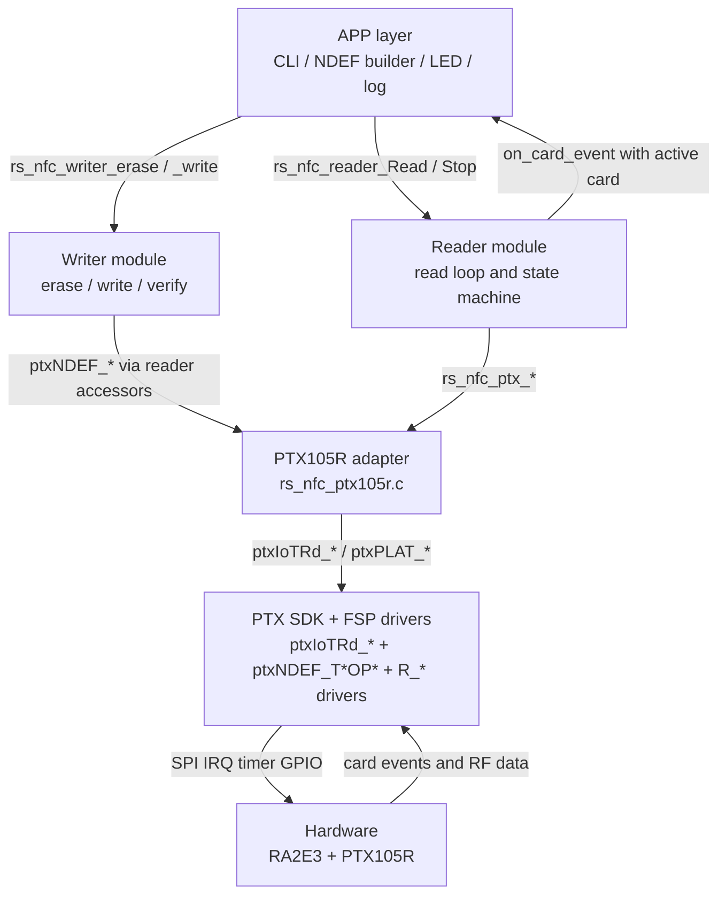

**One runtime cycle (one CLI command)**

1. APP parses the command and, for `write`, builds the NDEF Text record.
2. APP calls `rs_nfc_reader_Read()` with a 15 s timeout — blocking, because `cfg.callback == NULL`.
3. The reader performs discovery and waits for card activation.
4. The reader activates the card, reads card info, and reads/decodes the NDEF message.
5. The reader fires `on_card_event` while the tag is still activated.
6. Inside that callback, APP prints the card info and calls the writer helper for the selected op. The helper writes, then read-back verifies, before returning.
7. APP sets `card_handled` and calls `rs_nfc_reader_Stop()`, so the loop exits after one tag.
8. The reader deactivates the card and `rs_nfc_reader_Read()` returns; the CLI prints the prompt again.

Step 5 is the whole reason the writer needs no loop of its own — and also the reason the
card pointer must not be cached (see [11. Limitations](#11-limitations)).

### 7.3 FreeRTOS Task Map

> **Difference from the NFC Card Reader demo:** that project runs the reader in
> **non-blocking** mode, which spawns a separate `RS_NFC` worker task. This project passes
> `cfg.callback = NULL`, so `rs_nfc_reader_Read()` runs the blocking flow directly on
> the calling task. No `RS_NFC` task is created, and the whole NFC event loop executes
> on `new_thread0`.

| Task | Created by | Stack | Priority | Role |
|---|---|---|---|---|
| `new_thread0` | FSP (static) | 5 KB (5120 B) | 1 | Runs `app_nfc_writer_entry()` forever: CLI + blocking NFC event loop |
| `IDLE` | FreeRTOS kernel | 512 B | 0 | FreeRTOS idle task |

**Per-task notes**

- `new_thread0`: unlike the reader demo, this task never suspends. It owns the CLI loop *and*, during a command, the full discovery/activate/read/write/verify path. Keep this in mind when sizing its stack — the deepest call path in this firmware runs here, not on a separate worker. The 5,120 B figure is set in `ra_gen/new_thread0.c` (regenerated from `configuration.xml`); the writer's read-back verify puts its compare buffers on this stack, ~502 B on the T2T arm, so roughly 10% of it.
- `IDLE`: mandatory kernel task that runs when no other ready task exists. It provides background kernel housekeeping and must always have enough stack for the port's idle-path hooks. The idle hook is enabled in `configuration.xml`; the application does not define `vApplicationIdleHook()`, so FSP's default (weak) hook runs.
- `configCHECK_FOR_STACK_OVERFLOW` is deliberately left enabled because the stacks are sized tightly; `vApplicationStackOverflowHook()` lives in `src/hal_entry.c`.

> **Note:** All task stacks are statically allocated. `configSUPPORT_STATIC_ALLOCATION` must be `1` in `FreeRTOSConfig.h`. The FreeRTOS heap (2 KB) is reserved for the kernel; the C library uses the separate 256 B BSP heap — see [Heap](#heap).

### 7.4 Project Configuration

The writer has no configuration struct of its own. The application configures the
*reader* once per command and passes the resulting card into the writer helpers.

#### Configuration Struct

`rs_nfc_reader_cfg_t` (from `rs_nfc_reader.h`) is the input. `app_run_op()` fills it as follows:

```c
rs_nfc_reader_cfg_t cfg;
memset(&cfg, 0, sizeof(cfg));
cfg.tech_mask             = RS_NFC_TECH_ALL;
cfg.timeout_ms            = APP_CLI_CARD_TIMEOUT_MS;   /* 15000 */
cfg.retry_count           = 0u;
cfg.read_ndef             = true;
cfg.max_ndef_bytes        = RS_NFC_NDEF_MAX_BYTES;
cfg.run_raw_exchange      = false;
cfg.callback              = NULL;                      /* => BLOCKING */
cfg.p_context             = NULL;
cfg.on_card_event         = on_nfc_card_event;         /* writer runs in here */
cfg.p_card_event_context  = &ctx;                      /* selected op + payload */
cfg.validate_dependencies = false;
cfg.cfg_valid_check_en    = true;
```

| Field | Value here | Why |
|---|---|---|
| `tech_mask` | `RS_NFC_TECH_ALL` | Poll every technology so any tag type can be written |
| `timeout_ms` | `APP_CLI_CARD_TIMEOUT_MS` (15 s) | A CLI command must return to the prompt; the reader demo uses `RS_NFC_TIMEOUT_INFINITE` instead |
| `retry_count` | `0` | One attempt per command; the user can simply retype the command |
| `read_ndef` | `true` | Every op starts by reading the tag, so `erase`/`write` can report what was there |
| `run_raw_exchange` | `false` | Not needed — the writer uses the NDEF components, not raw frames |
| `callback` | `NULL` | Selects the blocking flow, so no worker task and no completion callback |
| `on_card_event` | `on_nfc_card_event` | The hook where the writer helpers are called, while the tag is activated |
| `p_card_event_context` | `&ctx` | Carries `app_op_t` plus the NDEF payload into the callback |
| `cfg_valid_check_en` | `true` | Must be set explicitly — `memset` zeroes it to `false` |

#### Result Struct

`rs_nfc_card_result_t` is the per-card payload handed to `on_card_event`, and it is
**also the writer's input**. Fields the writer relies on:

| Field | Type | Role for the writer |
|---|---|---|
| `protocol` | `ptxIoTRd_CardProtocol_t` | Selects the write/erase/verify path (`Prot_T2T` / `Prot_ISODEP` / `Prot_T3T` / `Prot_T5T`). Anything else → `RS_ERR_INVALID_CFG` |
| `data_area_size` | `uint32_t` | Tag capacity. When `> 0`, `write()` rejects an oversized message up front with `RS_ERR_BUFFER_OVERFLOW`; when `0` the guard is skipped and the read-back verify is the only guard |
| `ndef_present` / `ndef_data` / `ndef_len` | — | What was on the tag before the op — printed by the app |
| `decoded` | `rs_ndef_decoded_t` | Records parsed from `ndef_data`; each `payload` points into `ndef_data`, valid only while the result is alive |
| `writeable` | `bool` | Informational — reported by the tag; the writer does not gate on it |
| `tag_type_name` | `const char *` | Human-readable tag description. Static string — do not free |

The full struct definition is in `rs_nfc_reader.h`; the reader project's README documents
every field.

### 7.5 Project Functions

#### Writer Functions Reference

| Function | Purpose | Notes |
|---|---|---|
| `rs_nfc_writer_erase(card)` | Write a zero-length NDEF message, then verify the tag reads back empty | Returns `RS_OK` only when erased and verified |
| `rs_nfc_writer_write(card, ndef, ndef_len)` | Write a raw NDEF message, then verify the read-back matches | `ndef_len` is `1..RS_NFC_WRITE_MAX_BYTES` (248) |
| `rs_nfc_writer_verify(card, ndef, ndef_len)` | Standalone read-back check against an expected message | `ndef == NULL` / `ndef_len == 0` verifies an *erase* |

All three take the reader's `rs_nfc_card_result_t *` and must be called from
`on_card_event` while the tag is still activated. The module is payload-agnostic: it
does not build NDEF records for you — the demo's `build_ndef_text_record()` shows one way
to produce a message.

#### Reader Functions Reference

| Function | Purpose | Notes |
|---|---|---|
| `rs_nfc_reader_Read(cfg, result_out)` | Start the NFC flow | Blocking when `callback == NULL` (as used here), non-blocking otherwise |
| `rs_nfc_reader_Stop()` | Stop a running read | Called from `on_card_event` to make each CLI command one-shot. Returns `RS_OK` always |

#### What To Keep In Mind

- `on_card_event` is the only place a writer helper may be called. The card pointer is dead as soon as the callback returns.
- `write()` and `erase()` verify internally — do not call `verify()` again after them; use `verify()` only for a tag you did not just write.
- The result struct is reused by the reader, so copy anything you need before returning.
- `RS_NFC_WRITE_MAX_BYTES` (248) is the per-write cap, set by the tightest tag type (T2T). The demo's `APP_TEXT_MAX` subtracts the 7-byte Text-record overhead from it.

---

## 8. Callback Behavior

### 8.1 Runtime Flow

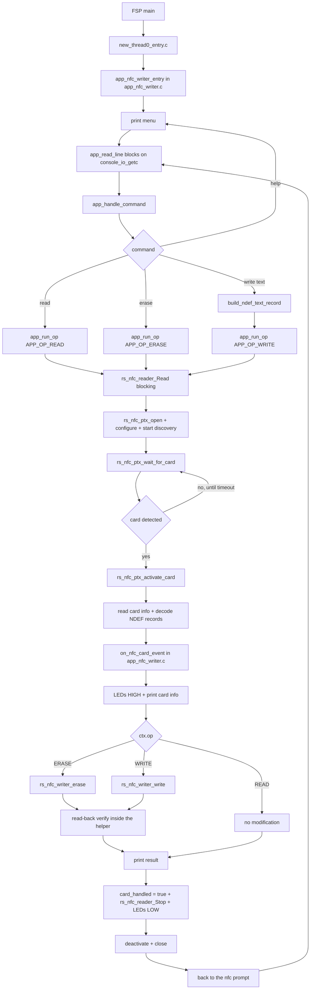

### 8.2 File-Level Ownership Flow

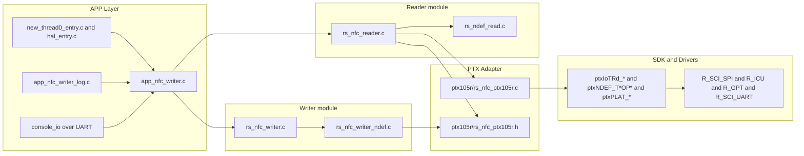

### 8.3 NDEF Write Decision Flow

`rs_nfc_writer_ndef_write()` dispatches on `card->protocol`. Erase is the same path with
a zero-length message.

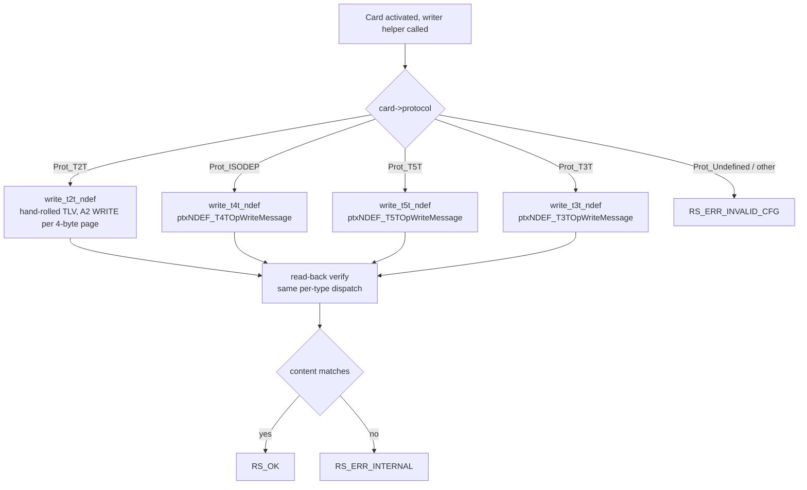

> **Note:** T2T is the only type written by hand (`0xA2` WRITE, 4 bytes per page, NDEF
> TLV + terminator TLV). The other three delegate to the PTX SDK's `ptxNDEF_T*OP`
> components, each of which is `CheckMessage`-d before the write.

### 8.4 Stop Path Flow

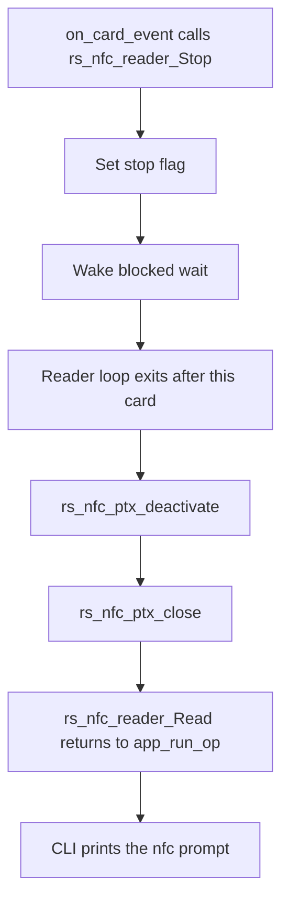

---

## 9. Configuration Parameters

Key FSP and firmware configuration options:

| Parameter | File | Default | Purpose |
|---|---|---|---|
| `configMAX_PRIORITIES` | `FreeRTOSConfig.h` | 3 | Task priority levels |
| `configTIMER_TASK_STACK_DEPTH` | `FreeRTOSConfig.h` | 128 | FreeRTOS timer task stack size (words) |
| `RS_NFC_NDEF_MAX_BYTES` | `rs_nfc_reader.h` | 512 | Maximum NDEF message read size |
| `RS_NFC_WRITE_MAX_BYTES` | `rs_nfc_writer.h` | 248 | Maximum NDEF message write size (bounded by T2T) |
| `APP_CLI_CARD_TIMEOUT_MS` | `app_nfc_writer.c` | 15000 | How long one command waits for a tag |
| `APP_CLI_LINE_MAX` | `app_nfc_writer.c` | 256 | Longest CLI line accepted |
| `APP_TEXT_MAX` | `app_nfc_writer.c` | 241 | `RS_NFC_WRITE_MAX_BYTES - 7` — max `write <text>` length |
| `APP_NFC_WRITER_LED_EN` | `app_nfc_writer.h` | defined | Compile in the LED feedback code |
| `UART baud rate` | FSP Configurator (`g_uart_jlob_vcom`) | 230400 | CLI + log speed |
| `SPI clock` | FSP Configurator (`ptx_pmod_spi`) | 1 MHz | PTX105R SPI communication speed |
| `new_thread0` stack | `configuration.xml` (FreeRTOS thread) | 5120 B | Stack for the CLI and the whole NFC path |
| `configtotal_heap_size` | `configuration.xml` (FreeRTOS) | 2048 B | FreeRTOS `heap_4` — kernel objects |
| `config.bsp.common.heap` | `configuration.xml` (BSP) | 256 B | C library `malloc` heap — see [Heap](#heap) |

> **Note:** This device has 64 KB of code flash and 16 KB of SRAM, and the PTX NFC stack fills
> most of the flash — the `ptxNSC_uCODE` firmware image alone is about 16 KB. The image only
> fits with the size settings of the e² studio project, in both Debug and Release:
> -Oz, -flto and `-Wl,--icf=safe`, with the console in `src/console_io` instead of
> libc `printf`. Adding code, or even console strings, can overflow
> it; see [14. Troubleshooting](#14-troubleshooting) if the link fails.

### Heap

The project has two independent heaps:

- FreeRTOS `heap_4` — `config.awsfreertos.thread.configtotal_heap_size` = 2,048 bytes. Used
  by the kernel for dynamically created objects.
- BSP / C library heap — `config.bsp.common.heap` = 256 bytes. Serves the C library `malloc`;
  no `malloc` → `pvPortMalloc` aliasing is applied in this project. The NFC Reader PTX module
  requires this heap to be > 0 (the console does not use it).
- The NFC modules never allocate. `src/rs_nfc_card_writer/` contains no `malloc`, `calloc` or
  `free`; every working buffer is stack-local.
- If you add allocating code, size the heap it draws from accordingly — `pvPortMalloc()` and
  `malloc()` both return `NULL` when their heap is exhausted.

---

## 10. Error Handling

Common error scenarios and recovery. Both modules report status via the `rs_status_t`
enum (`rs_nfc_reader.h`).

**Reader-side (starting or running a command)**

| Status / Error | Cause | Recovery |
|---|---|---|
| `RS_ERR_TIMEOUT` | No tag presented inside `APP_CLI_CARD_TIMEOUT_MS` | Re-run the command; the CLI prints `No tag (timeout)` |
| `RS_ERR_INVALID_CFG` | Malformed `rs_nfc_reader_cfg_t` | Fix config fields; keep `cfg_valid_check_en = true` |
| `RS_ERR_DEPENDENCY` | Lower PTX105R stack not ready | Verify FSP stack + `validate_dependencies` |
| `RS_ERR_NOT_FOUND` | Card not NDEF-formatted | Reported and the op continues / returns to prompt |

**Writer-side (returned by `erase` / `write` / `verify`)**

| Status / Error | Cause | Recovery |
|---|---|---|
| `RS_ERR_INVALID_CFG` | `card == NULL`, a zero-length or oversized payload (`ndef_len > RS_NFC_WRITE_MAX_BYTES`), or `card->protocol` is not T2T / ISO-DEP / T3T / T5T | Check the tag type and the payload length |
| `RS_ERR_BUFFER_OVERFLOW` | Message larger than the tag's reported capacity (`data_area_size > 0`) | Shorten the payload; use a higher-capacity tag |
| `RS_ERR_NOT_FOUND` | The tag could not be re-read during verification — most often because the card pointer was cached and used after `on_card_event` returned, so no card is selected | Call the helper inside `on_card_event` |
| `RS_ERR_INTERNAL` | Read-back content mismatch, or an SDK write failure | Re-present the tag; check it is not write-protected, and that the message fits when `data_area_size == 0` |

> **Note:** a failed write may leave the tag partially written, particularly for T2T
> where pages are written one at a time. Re-run `erase` before retrying if a write fails
> mid-way.

---

## 11. Limitations

* **Card pointer lifetime**: `rs_nfc_card_result_t` is valid only for the duration of `on_card_event`, while the tag is ACTIVATED. Caching it and calling a writer helper later fails (typically `RS_ERR_NOT_FOUND`) because the reader has already deactivated the tag.
* **Capacity guard is best-effort**: the up-front size check only runs when the reader reported `data_area_size > 0`. If capacity is unknown, an over-large message may be written and then fail the internal read-back verify with `RS_ERR_INTERNAL`.
* **Write size**: capped at `RS_NFC_WRITE_MAX_BYTES` (248 bytes) per write, set by the T2T hand-rolled writer; longer payloads are rejected with `RS_ERR_INVALID_CFG`. The CLI's `write <text>` is further capped at 241 characters by the Text-record overhead.
* **Partial writes are possible**: an interrupted T2T write leaves earlier pages written; there is no rollback.
* **NDEF T3T (FeliCa) read**: write and read-back verify are supported, but the reader module does not decode T3T NDEF content, so the `read` command reports the tag and UID without NDEF content.
* **Non-NDEF writes**: not supported. There is no raw block/sector write API — the writer only writes complete NDEF messages.
* **No record builder**: the project is payload-agnostic; the application must build the NDEF message. Only a Text record builder ships with the demo.
* **One card per command**: each CLI command stops after the first tag; only one card can be activated per read cycle.
* **Blocking CLI**: the demo runs the reader in blocking mode on `new_thread0`, so nothing else runs on that task during a command.
* **SPI transport scope**: the PTX105R integration is validated only with SCI-SPI. Dedicated RA SPI peripherals such as `R_SPI` are not supported in this release.
* **RA2E3 RAM**: 16 KB total; dynamic allocation is minimal. All task stacks are statically allocated.
* **Heaps**: FreeRTOS `heap_4` is 2 KB for kernel objects; the BSP / C library `malloc` heap is 256 B — see [Heap](#heap).
* **ISO 15693 (NFC-V)**: basic detection supported; advanced features (AFI, DSFID) not implemented.
* **Flash is nearly full**: the image only fits with the project's size settings (`-Oz`, `-flto`, `--icf=safe`, integer-only `printf`) — see [9. Configuration Parameters](#9-configuration-parameters).

---

## 12. Integration Recommended

> **Note:** If you're running the packaged demo on the reference hardware, see [3. Demo Bring-Up](#3-demo-bring-up). This section is intended for integrating the code into your own project and hardware.

When moving to a different RA MCU board, only a few layers need to change — both modules, the NDEF layers, and the overall application flow are portable, and the APP layer can be reused as-is or adapted to your product behavior. The integration touch-points are concentrated in `configuration.xml` (BSP device, stacks, pins) and the two PTX board-adapter files (`rs_nfc_ptx105r_board.h` / `rs_nfc_ptx105r.c`) — both of which live in the reader module, since the writer ships no backend.

This section walks through that work:

* [12.1 Integration Guide](#121-integration-guide) — the ordered, step-by-step procedure.
* [12.2 Adapting to Custom Board Wiring](#122-adapting-to-custom-board-wiring) — the signal-by-signal remapping reference.
* [12.3 Integration Checklist](#123-integration-checklist) — final verification before running on your board.

---

### 12.1 Integration Guide

Follow these steps, in order, when bringing this code into your own project or custom hardware:

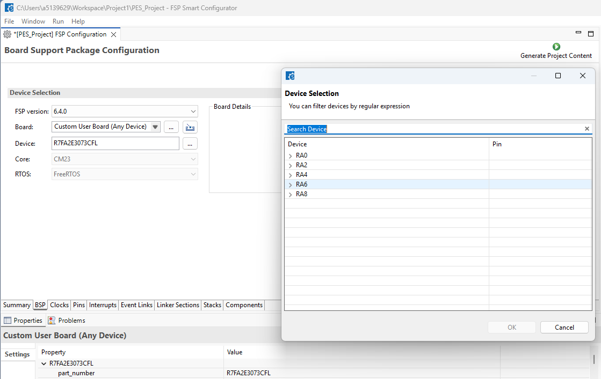

*Figure 7 — BSP Device Selection*

1. Select the BSP device, then verify required MCU modules using the Hardware User's Manual (HWUM). In `configuration.xml` BSP tab, select your exact MCU/device package first (Figure 7). Then confirm that device has: an SPI-capable SCI channel (or a dedicated SPI channel), an external-IRQ-capable pin, a spare GPIO output for reset/chip-select, a DTC/DMAC channel for SPI transfers, and — for the CLI — a spare UART channel. Also confirm two GPT timer channels are available for the PTX timing services (`g_timer0` / `g_timer1`).
2. Verify pin/channel mapping against your schematic. Cross-reference the MCU pin-function tables in the HWUM with your board schematic to decide which physical pins will carry SPI (MISO/MOSI/SCK/CS), IRQ, RESET, and UART. Use [12.2 Adapting to Custom Board Wiring](#122-adapting-to-custom-board-wiring) as the list of what to reassign in `configuration.xml` and `rs_nfc_ptx105r_board.h`.
3. Selectively import only the layers you need into your project's `src/`.
   - Always required: the whole of `src/` from this repository's root — that is the PTX adapter (`ptx105r/`), the reader files (`rs_nfc_reader.c`, `rs_ndef_read.c`) and the writer files (`rs_nfc_writer.c`, `rs_nfc_writer_ndef.c`). Take it as one unit: the writer cannot be taken without the reader, because it calls into the reader's PTX105R backend.
   - Optional: `src/app/` (CLI, LED, log) and `src/console_io/` — omit or replace with your own application layer. Drop these if you drive the writer helpers from your own code rather than a UART CLI.
   - Do not copy: `ra/`, `ra_gen/` and `ra_cfg/` — these are FSP-generated and must be produced fresh for your own project/board configuration (see [7.1 Project Structure](#71-project-structure)).
4. Wire up the include paths. Add the folder holding the project sources and its `ptx105r/` subfolder (here: `src/rs_nfc_card_writer` and `src/rs_nfc_card_writer/ptx105r`) — `rs_nfc_writer_ndef.c` includes `rs_nfc_ptx105r.h` from the latter. The PTX SDK headers (`ptx_IOT_READER.h`, `ptxNDEF_T3TOP/T4TOP/T5TOP.h`) come from the generated `ra/` tree via the `rm_nfc_reader_ptx` stack, so they resolve once Generate Project Content has run.

Once these steps are complete, validate the result against [12.3 Integration Checklist](#123-integration-checklist).

---

### 12.2 Adapting to Custom Board Wiring

When moving the PTX105R connection off the reference PMOD1 wiring (for example, onto a customer's own board or a different connector layout), the following signals can be remapped. Most changes are confined to `configuration.xml` (Stacks + Pins) and are picked up through the FSP-generated headers; `rs_nfc_ptx105r_board.h` exposes the external-IRQ instance/callback used by the adapter.

| Signal | Reference (FPB-RA2E3) | What can change | Where to update |
|---|---|---|---|
| SPI (MISO/MOSI/SCK/CS) | SCI0 · P100–P103 | Any SCI channel with SPI support (see 5.3 [SCI0 SPI & ICU IRQ7 Properties](#53-sci0-spi--icu-irq7-properties)) | `configuration.xml` Stacks tab (`ptx_pmod_spi`) + Pins tab |
| DTC transfer instances | `g_transfer0` (TX) / `g_transfer1` (RX) on SCI0 | Must be reassigned to match the new SCI channel's transfer request line | `configuration.xml` Stacks tab — regenerate after changing the SPI channel |
| IRQ | ICU IRQ7 · P015 | Any external-IRQ-capable pin | `configuration.xml` Stacks (`g_ext_irq`) + Pins tab — see note in 5.3 [SCI0 SPI & ICU IRQ7 Properties](#53-sci0-spi--icu-irq7-properties) (`vector_data.h`/`common_data` regenerate); the adapter picks up `g_ext_irq` via `rs_nfc_ptx105r_board.h` |
| RESET | GPIO P915 (`PMOD1_RESET`) | Any GPIO output pin | `configuration.xml` Pins tab (macro `PMOD1_RESET` in generated `bsp_pin_cfg.h`) |
| UART (CLI + log) | SCI9 · P109 (TX) / P110 (RX) | Any UART-capable SCI channel. Cannot be omitted while the demo CLI is used — it is the command input | `configuration.xml` (`g_uart_jlob_vcom`); `src/app/app_nfc_writer_log.c`, `src/console_io/` |
| Power | 3.3 V from PMOD1 rail | PTX105R always requires a regulated 3.3 V supply from the host board | Host board power rail |

> **Note:** If the target is a different RA MCU (not just different wiring on the same MCU), also re-verify the clock tree in `bsp_clock_cfg.h` and the availability of the two GPT timer channels used by `g_timer0` / `g_timer1`.

---

### 12.3 Integration Checklist

Before running your application on your own board, verify the following (values shown for the reference FPB-RA2E3/PTX105R setup are examples only — substitute your own MCU, channels, and pins):

* [ ] Target device and BSP in FSP match your hardware (MCU part number, package, FSP version) — confirmed against your MCU's HWUM.
* [ ] Required peripheral modules are available on your MCU and not already claimed by another function: an SPI-capable channel, an external-IRQ-capable pin, a GPIO output, a DTC/DMAC channel, and a UART channel — see 12.1 [Integration Guide](#121-integration-guide).
* [ ] Pin/channel mapping matches your schematic for SPI (MISO/MOSI/SCK/CS), IRQ, RESET, and UART — see 12.2 [Adapting to Custom Board Wiring](#122-adapting-to-custom-board-wiring).
* [ ] Both modules are present and compiled — the writer files *and* the reader files they depend on — with the project source folder and its `ptx105r/` subfolder on the include path.
* [ ] PTX SDK NDEF headers resolve (`ptx_IOT_READER.h`, `ptxNDEF_T3TOP/T4TOP/T5TOP.h`) — they come from the generated `ra/` tree, so Generate Project Content has been run.
* [ ] PTX105R middleware stack exists and is connected: NFC reader config instance + SPI bus instance + SPI device instance (`g_nfc_reader_ptx0` / `g_comms_spi_bus0` / `g_comms_spi_device0`, or your renamed equivalents).
* [ ] SPI driver instance is configured to match the PTX105R spec: master, 1 MHz, CPOL=0, CPHA=0 (see 4.2 [PTX105R QC PMOD Board](#42-ptx105r-quick-connect-qc-pmod-board)), on the channel you selected.
* [ ] DTC (or DMAC) transfer instances for SPI TX/RX are enabled and match the SPI channel you selected.
* [ ] External IRQ instance is configured on the pin you selected, with rising-edge trigger.
* [ ] PTX reset GPIO is present, configured as output, and wired to the pin you selected.
* [ ] UART instance exists on the channel/pins you selected, and your terminal sends keystrokes (the CLI is interactive).
* [ ] Terminal baud matches the FSP `g_uart_jlob_vcom` baud setting (230400 8N1 by default); the log backend lives in `src/app/app_nfc_writer_log.c` and the console in `src/console_io/`.
* [ ] FreeRTOS settings are valid for your app: `configSUPPORT_STATIC_ALLOCATION=1`, and `new_thread0`'s stack is sized for the blocking NFC path (see 7.3 [FreeRTOS Task Map](#73-freertos-task-map)).
* [ ] Project builds and links with no unresolved symbols from the NFC reader/writer/PTX, SPI, IRQ, DTC/DMAC, and UART components you selected.
* [ ] Hardware wiring is correct per your schematic: PTX105R module wired to the pins you selected, and UART adapter connected with matching RX/TX/GND.
* [ ] A write is confirmed end-to-end: `write test` returns `Written + verified`, and a following `read` shows the same message.

---

## 13. Example

### Typical NDEF Write Sequence

```c
#include "rs_nfc_writer.h"      /* pulls in rs_nfc_reader.h */
#include "FreeRTOS.h"
#include "task.h"
#include <string.h>

/* What this command should do to the tag. */
typedef struct { const uint8_t *ndef; uint16_t len; volatile bool done; } my_ctx_t;

/* ① Per-card event callback. `result` is valid ONLY for this call, while the
 *    tag is still ACTIVATED — this is the only place a writer helper may run. */
static void my_card_event(rs_status_t                  status,
                          const rs_nfc_card_result_t * result,
                          const char                 * summary,
                          void                       * p_context)
{
    my_ctx_t * ctx = (my_ctx_t *)p_context;
    (void)status;

    if (NULL == result)                 /* informational / warning event */
    {
        if (NULL != summary) { /* log summary */ }
        return;
    }

    /* The reader has already read the tag; result->ndef_data holds what was
     * on it (result->ndef_len bytes). Now write the new message. */
    rs_status_t st = rs_nfc_writer_write(result, ctx->ndef, ctx->len);

    if (RS_OK == st)
    {
        /* Written AND read-back verified — no separate verify() needed. */
    }
    else if (RS_ERR_BUFFER_OVERFLOW == st)
    {
        /* Message exceeds the tag capacity the reader reported. */
    }

    /* One-shot: stop after the first tag so the caller regains control. */
    ctx->done = true;
    (void)rs_nfc_reader_Stop();
}

/* ② Drive the READER; the write happens inside its callback. */
void write_one_tag(const uint8_t *ndef, uint16_t ndef_len)
{
    my_ctx_t ctx = { .ndef = ndef, .len = ndef_len, .done = false };

    rs_nfc_reader_cfg_t cfg;
    memset(&cfg, 0, sizeof(cfg));
    cfg.tech_mask             = RS_NFC_TECH_ALL;
    cfg.timeout_ms            = 15000u;              /* finite: give up eventually */
    cfg.read_ndef             = true;                /* read before writing */
    cfg.max_ndef_bytes        = RS_NFC_NDEF_MAX_BYTES;
    cfg.callback              = NULL;                /* NULL => BLOCKING flow */
    cfg.on_card_event         = my_card_event;
    cfg.p_card_event_context  = &ctx;
    cfg.cfg_valid_check_en    = true;                /* memset zeroed it to false */

    /* Blocks until a tag is handled or the timeout elapses. */
    if (RS_OK != rs_nfc_reader_Read(&cfg, NULL)) { /* handle start failure */ }
    else if (!ctx.done)                            { /* timed out, no tag   */ }
}

/* ③ Erasing is the same shape — call rs_nfc_writer_erase(result) instead. */
```

> **Note:** pass `NULL` for `result_out` — the reader uses its own result buffer and hands
> you a pointer in the callback. Do not keep that pointer past the callback.

---

## 14. Troubleshooting

**Symptom**: `nfc>` prompt never appears, or typing does nothing
- Confirm the terminal sends keystrokes and RX is wired (P110). This app needs bidirectional UART — see [4.4 USB UART](#44-usb-uart-cli--log).
- Verify baud is 230400 8N1.
- Confirm `src/console_io/` contains `console_io.c` and `console_io.h`, and that the `src/console_io` include path is set in both build configurations.

**Symptom**: build fails on `rs_nfc_writer.h` / `rs_nfc_ptx105r.h` not found
- Check the include paths point at `src/rs_nfc_card_writer` and `src/rs_nfc_card_writer/ptx105r` (e² studio: Properties → C/C++ Build → Settings → Compiler → Includes).
- The `src/` folders are ordinary directories, not generated links, so there is nothing to create or repair.

**Symptom**: build fails on `ptxNDEF_T4TOP.h` / `ptx_IOT_READER.h` / `hal_data.h` not found
- The FSP trees have not been generated. Right-click the project → Generate Project Content (or open `configuration.xml` and press it) to produce `ra/`, `ra_gen/` and `ra_cfg/`. They are deliberately not committed, so a fresh clone lacks them until you generate.
- This needs FSP 6.5.0 with the `Renesas.PTX.3.0.0+fsp.6.5.0` pack installed in e² studio; the PTX SDK arrives with the `rm_nfc_reader_ptx` stack.

**Symptom**: link fails with `region FLASH overflowed`
- The image has very little margin in the 64 KB code flash.
- Check that both build configurations still have -Oz, Link-time optimizer (-flto), Identical code folding: safe (`-Wl,--icf=safe`), and that nothing calls libc `printf`/`snprintf`/`getchar` (use `APP_LOG`), then reduce console strings or application code.

**Symptom**: console is completely silent
- Check 230400 8N1 on the J-Link OB VCOM port.
- If nothing at all appears, pin configuration has not run — `R_BSP_WarmStart()` in `src/hal_entry.c` must call `R_IOPORT_Open()`, and it must be the only definition of that function in the project.

**Symptom**: no cards detected
- Verify PTX105R power supply (3.3 V)
- Check antenna connection; ensure J2 jumper closed on FPB-RA2E3
- Confirm GPIO and SPI pin mappings in FSP Configurator
- Test with e² studio debugger; check `rs_nfc_ptx_start_discovery` return code
- Ask the reader module what it sees: `rs_nfc_reader_GetWaitState()` reports the state of the most
  recent wait for a card (optional, `RS_NFC_WAIT_STATE_ENABLED`, on by default). Build with
  `APP_NFC_WAIT_STATE_EXAMPLE=1` and the CLI prints it after `No tag (timeout)`:

| State | Meaning | What to check |
|---|---|---|
| `RS_NFC_WAIT_NO_IRQ_YET` | Waiting. The reader has not signalled since this wait began | Is a tag in range? If so, the IRQ line, its pin and edge configuration |
| `RS_NFC_WAIT_IRQ_SEEN` | Waiting. The reader signalled, but no tag was reported yet | Tag type and position, reader state, RF settings |
| `RS_NFC_WAIT_CARD` | A tag was detected | Normal |
| `RS_NFC_WAIT_TIMEOUT_NO_IRQ` | Timed out, no interrupt seen | As `NO_IRQ_YET` |
| `RS_NFC_WAIT_TIMEOUT_IRQ_NO_CARD` | Timed out, interrupt seen but no tag reported | As `IRQ_SEEN` |
| `RS_NFC_WAIT_READER_ERROR` | The reader reported a fault, or its status could not be read | Supply and temperature, then SPI wiring, clock and chip select |
| `RS_NFC_WAIT_NONE` | No wait has started yet | Start a read |

"Interrupt seen" means seen while the reader module was waiting. It prints nothing:
`examples/fpb-ra2e3/src/app/app_nfc_writer_wait_state.c` shows how an application turns the state
into text and prints it through `APP_LOG`.

**Symptom**: `NDEF write/verify FAILED (err -N)`
- `RS_ERR_INVALID_CFG`: the tag type is not one of T2T / ISO-DEP / T3T / T5T.
- `RS_ERR_BUFFER_OVERFLOW`: message too large for the tag's reported capacity — shorten the text.
- `RS_ERR_NOT_FOUND`: the tag left the field mid-operation, or a cached card pointer was used outside `on_card_event`.
- `RS_ERR_INTERNAL`: read-back mismatch. Check the tag is not write-protected, then run `erase` and retry — a failed write can leave the tag partially written.

**Symptom**: `write` succeeds but a later `read` shows nothing
- Some tags need re-formatting after an erase; try `write` again.
- For T3T, `read` cannot show NDEF content by design — verify with a phone or another reader.

**Symptom**: FreeRTOS heap exhausted or stack overflow during a command
- The blocking NFC path runs on `new_thread0` in this app; increase that task's stack rather than the heap.
- Review dynamic allocation in app; consider static buffers.

**Symptom**: intermittent card failures
- Extend `APP_CLI_CARD_TIMEOUT_MS` for slower cards.
- Verify antenna is tuned (antenna capacitance on FPB-RA2E3).
- Hold the tag still for the whole operation — a write plus read-back verify takes longer than a plain read.

---

## 15. Summary

This project provides a complete, ready-to-run interactive NFC card writer on the Renesas FPB-RA2E3 board using the PTX105R Quick-Connect PMOD.

* The NFC Writer module adds NDEF erase, write and verify on top of the NFC Reader module, reusing its discovery loop and PTX105R backend rather than duplicating them. `write()` and `erase()` read back and verify internally, so `RS_OK` means confirmed on the tag.
* NDEF write is supported for T2T (hand-rolled TLV), T4A/T4B (`ptxNDEF_T4TOP`), T3T (`ptxNDEF_T3TOP`) and T5T (`ptxNDEF_T5TOP`) — all four major tag families.
* A small UART CLI (`read` / `erase` / `write <text>` / `help`) drives the flow, so no rebuild is needed to change what gets written.
* The software stack is built on Renesas FSP v6.5.0 + FreeRTOS, compiled with LLVM (ATfE 21.1.1) and picolibc, with a layered architecture: APP → Writer + Reader modules → PTX adapter → PTX SDK + FSP drivers.
* Porting to another RA board requires changes only to `configuration.xml` (BSP/stacks/pins) and the PTX board-adapter files in the reader module — all other layers are unchanged.

---

## 16. References & Documentation

Project specific reference:

| Document | Description |
|---|---|
| NFC Card Reader project | The read-only reader this project builds on — full field-by-field reference for `rs_nfc_reader_cfg_t` and `rs_nfc_card_result_t`. Delivered alongside this package. |
| [FPB-RA2E3 User's Manual](https://www.renesas.com/en/products/microcontrollers-microprocessors/ra-cortex-m-mcus/fpb-ra2e3-fast-prototyping-board-ra2e3-mcu-group) | Board schematic, jumper positions, connector pinout |
| [PTX105R - Mid-power, Multi-protocol NFC Forum Compliant Reader Renesas](https://www.renesas.com/en/products/ptx105r) | PTX105R product page |
| [PTX105R Datasheet](https://www.renesas.com/en/document/dst/ptx105r-datasheet?srsltid=AfmBOoo1nI-a-YNJOhCNSXNbOdtv9vA-IlhP9sdv6T4lM7sctsYzoVpP) | PTX105R NFC IC electrical and RF specifications |
| [NFC Forum Type 2 Tag Operation Specification](https://nfc-forum.org/build/specifications) | The T2T page/TLV layout implemented by `write_t2t_ndef()` |

Renesas general reference:

| Document | Description |
|---|---|
| [e² studio Renesas](https://www.renesas.com/en/software-tool/e2-studio?srsltid=AfmBOorTMc82ySC1OUrEN8SZbrQK2qXPYpFT_VatUYLmZMBeViM4bFTS) | e² studio user guide and tool page |
| [Renesas FSP Documentation](https://renesas.github.io/fsp/) | FSP API reference for all modules used |
| [J-Link Software](https://www.segger.com/products/debug-probes/j-link/tools/j-link-software/) | SEGGER J-Link tools installer |

---

**Feedback & Support**

- [Renesas Wireless Connectivity Forum](https://community.renesas.com/wireles-connectivity)
- [Contact Technical Support](https://www.renesas.com/eu/en/support?nid=1564826&issue_type=technical)
- [Contact a Sales Representative](https://www.renesas.com/eu/en/buy-sample/locations)
